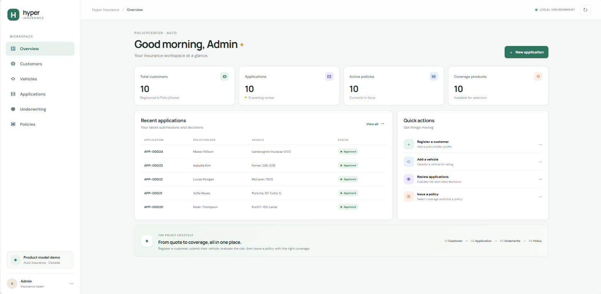
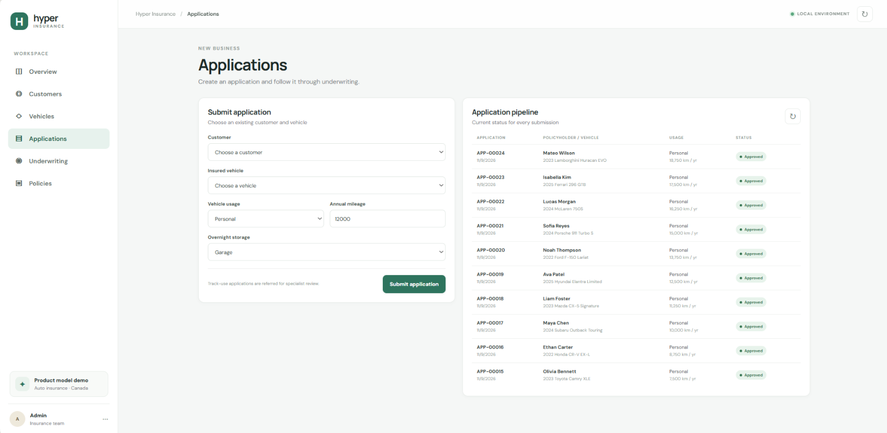
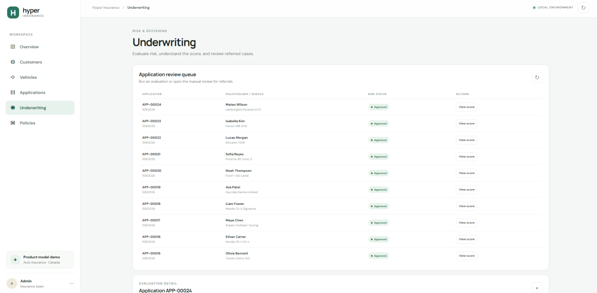
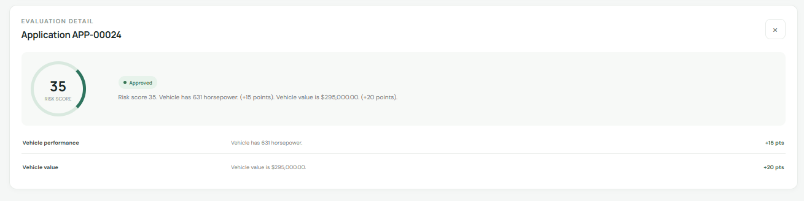
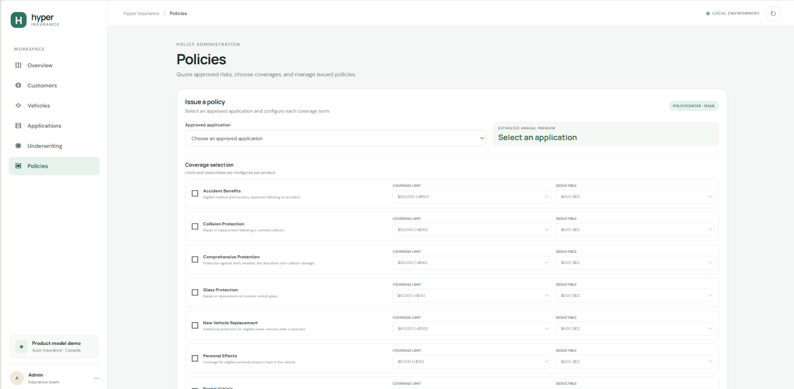
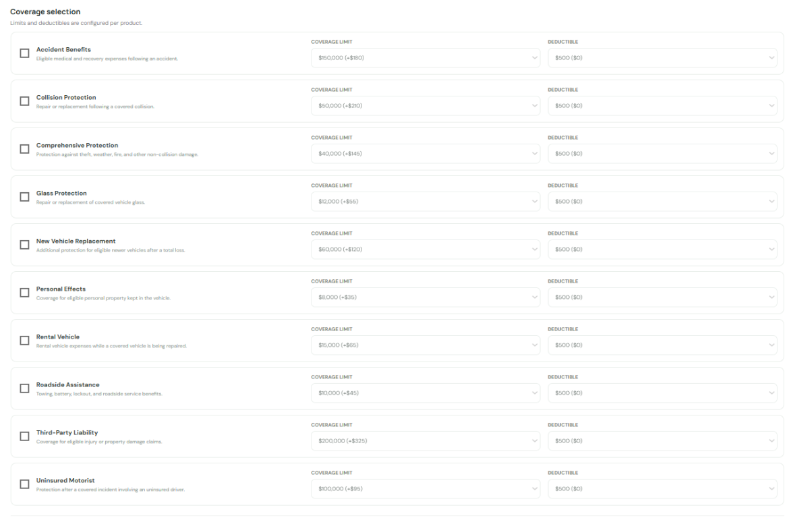
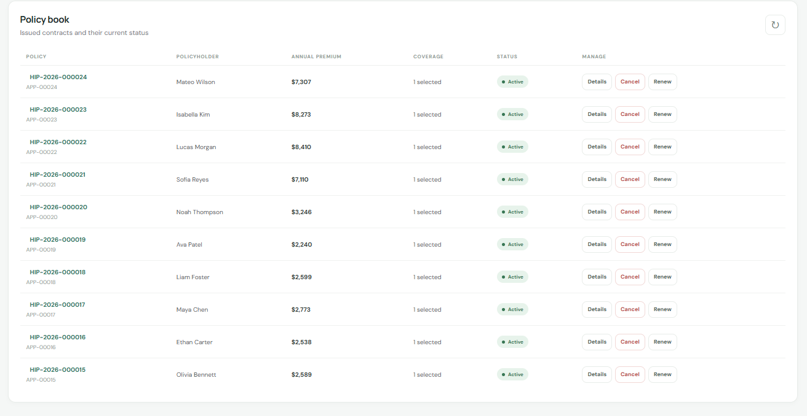
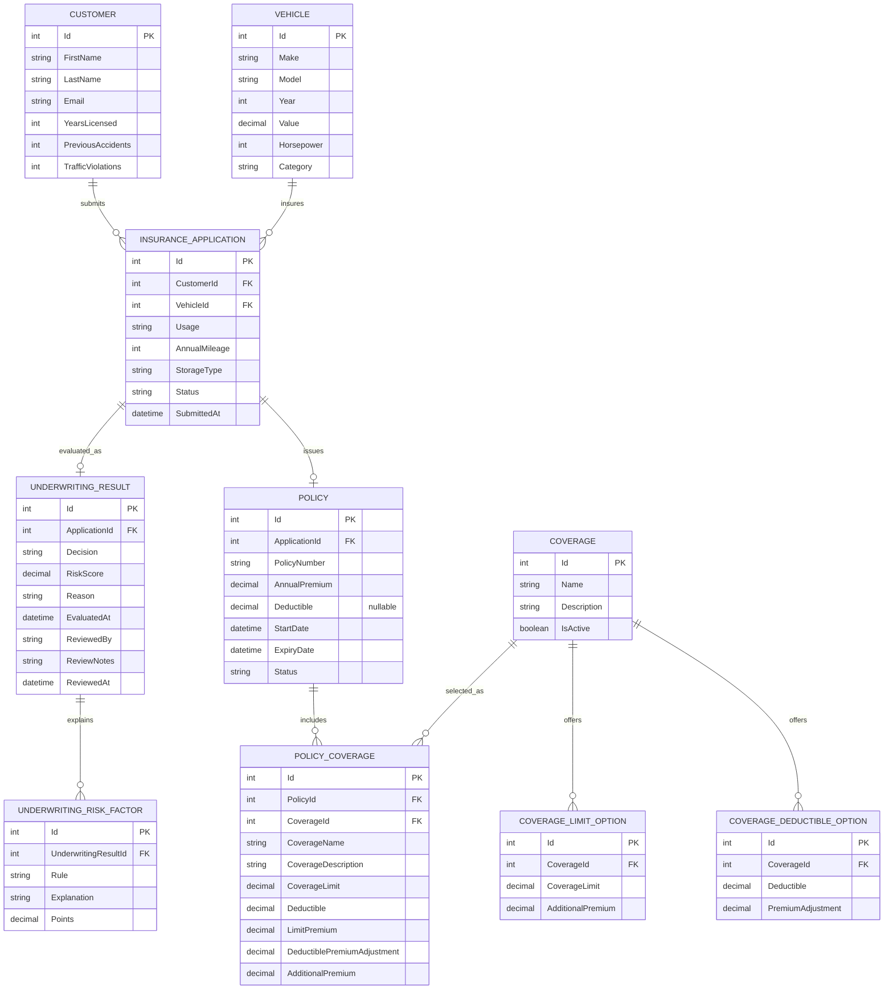

# Hyper Insurance

An automotive insurance project for managing policies, coverage, underwriting, and premiums, inspired by the workflows of Guidewire PolicyCenter.

## Project Overview

Hyper Insurance is an ASP.NET Core Web API backed by PostgreSQL. It explores common insurance-system concepts including customer and vehicle records, insurance applications, underwriting, premium calculation, coverage products, and policy management. A static web dashboard is served by the application alongside the API.

This is a Guidewire-inspired portfolio project, not a Guidewire product or implementation. It is intended to illustrate related insurance workflows and product-model concepts in a small, approachable application.

## Showcase

The dashboard and application preview below show the core insurance workflow in a desktop-style interface. The project keeps these screenshots in a `screenshots/` folder at the project root.

### Dashboard overview



### Application pipeline



### Underwriting decision





### Policy issuance and coverage selection





### Issued policy details



## Features

### Customer Management

- Register customers with contact details and basic driving history.
- Retrieve an individual customer or list customers.
- Validate required fields and non-negative driving-history values.

### Vehicle Management and Classification

- Register a vehicle with its make, model, model year, value, and horsepower.
- Automatically classify each vehicle as `Standard`, `Luxury`, `High-Performance`, `Supercar`, or `Hypercar`.
- Retrieve an individual vehicle or list vehicles.

Classification uses value and horsepower thresholds in `VehicleClassificationService`; it is demonstration logic rather than a real vehicle-rating standard.

| Category | Classification rule |
|---|---|
| `Hypercar` | Value of at least CAD 1,000,000 |
| `Supercar` | Value of at least CAD 250,000 and below CAD 1,000,000 |
| `High-Performance` | At least 500 horsepower, if no higher value category applies |
| `Luxury` | Value of at least CAD 100,000, if no higher category applies |
| `Standard` | None of the rules above apply |

### Insurance Application Management

- Submit an application that references an existing customer and vehicle.
- Store usage, annual mileage, storage type, submission time, and status.
- Retrieve individual applications or list applications with customer and vehicle details.
- Reject requests that reference missing customer or vehicle records.

Applications begin in `Pending` status. Underwriting updates the status to its decision.

### Automatic Underwriting

- Evaluate applications using separately registered underwriting rules.
- Produce an `Approved`, `Referral`, or `Declined` decision.
- Store a risk score, an overall explanation, and individual risk factors.
- Re-evaluate an application by updating its existing result rather than creating duplicate results.

### Manual Underwriting Reviews

- Record a reviewer, notes, review time, and a final `Approved` or `Declined` decision.
- Restrict manual reviews to applications currently in `Referral` status.

### Premium Calculation

- Calculate a base annual premium from customer, vehicle, and application details.
- Return a component-by-component quote through the rating API.
- Include selected coverage limit premiums and deductible adjustments when issuing a policy.
- Return premiums in CAD and round component amounts and totals to two decimal places.

The separate quote endpoint calculates the application premium without selected coverage terms. Policy issuance recalculates the premium with the coverage selections included.

### Insurance Product and Coverage Configuration

- Create, retrieve, update, and activate or deactivate coverage products through the API.
- Configure multiple coverage limit options, each with an additional premium.
- Configure multiple deductible options, each with a signed premium adjustment.
- List active products for selection or retrieve all product configurations, including inactive products.
- Validate configured options and reject duplicate limit or deductible values within a product.

The data model and API support this configuration. The dashboard does not currently have a product-configuration editing screen.

### Policy Issuance

- Issue one policy for an approved application.
- Accept coverage selections with limits and deductibles configured for each selected coverage. The current API also permits an empty coverage list.
- Reject duplicate, inactive, unknown, or invalid coverage selections.
- Save coverage names, descriptions, selected terms, and pricing on the policy.
- Return complete policy information, including its selected coverage details.
- Add an additional configured coverage to an active policy through the API.

### Policy Renewal, Cancellation, and Status

- Renew an active, unexpired policy by extending its expiry date by one year.
- Cancel an active policy.
- Retrieve a policy's status and dates.
- Report `Expired` from the status endpoint when an active policy's expiry date is today or earlier. This is computed for the response; the stored policy status is not changed by that check.

### Web Dashboard

The included dashboard provides customer and vehicle registration, application submission, underwriting evaluation and manual review, coverage selection during policy issuance, and policy list, detail, renewal, and cancellation workflows. It is served from `wwwroot` and uses the API.

### Automated Tests

The MSTest project covers vehicle classification, underwriting decisions and explanations, premium calculation, coverage selection, policy issuance and lifecycle operations, validation, and missing records. Tests use an isolated in-memory SQLite database rather than the configured PostgreSQL database.

## Technology Stack

| Technology | Version or configuration |
|---|---|
| C# | Application language; project targets `net10.0` |
| ASP.NET Core | .NET 10 Web SDK / Web API |
| PostgreSQL | Relational database, accessed through Npgsql and EF Core 10 |
| API documentation | Swagger UI, enabled in Development |
| Testing | MSTest with in-memory SQLite |


## Insurance Application Workflow

1. Register a customer and a vehicle. Vehicle registration assigns a category automatically.
2. Submit an application referencing those existing records, with usage, annual mileage, and storage type.
3. Evaluate the application. Underwriting rules calculate a risk score and decision and store explanatory risk factors.
4. An application is marked `Approved`, `Referral`, or `Declined`. Track use always causes a referral for specialist review.
5. A referred application can receive a manual review. The reviewer records notes and changes the decision to `Approved` or `Declined`.
6. Request an annual premium quote. This quote includes the base application factors; it does not accept selected coverage terms.
7. Issue a policy only for an approved application. Select active coverage products and one configured limit and deductible for each. Issuance recalculates the premium with those selected terms and saves them on the policy.
8. Retrieve a policy and its coverage details, add a configured coverage to an active policy, renew an eligible policy, cancel an active policy, or check its status.

## Underwriting and Rating

Underwriting combines modular rules into an `Approved`, `Referral`, or `Declined` decision with a risk score and explanations. Track use always triggers a referral. A referred application can receive a separate manual `Approved` or `Declined` decision.

The rating service returns an itemized annual premium based on customer, vehicle, and application details. Policy issuance recalculates the total using the selected coverage limits and deductible adjustments. All rules and amounts are fictional demonstration logic, not real insurance guidance.

## Product Configuration

A `Coverage` contains a name, description, and `IsActive` flag. Its configured terms are stored in related records:

- `CoverageLimitOption` stores a selectable limit and its non-negative additional premium.
- `CoverageDeductibleOption` stores a selectable deductible and its signed premium adjustment.

The configuration API exposes create, update, get, list, and activation operations. Active products are listed separately for selection; a configuration listing can include inactive products. Policy issuance and policy coverage additions verify that the selected product is active and that both selected terms exist in its current configuration.

When a policy coverage is saved, its product name, description, limit, deductible, and pricing components are copied to `PolicyCoverage`. This preserves the issued terms if the product configuration changes later. The dashboard supports selecting terms while issuing policies but does not currently provide screens to create or edit coverage products; use the API for product configuration.

## API Documentation

All endpoints are under `/api`. Unless specified otherwise, successful GET requests return JSON; request validation and resource errors use standard validation or Problem Details responses.

### Insurance

| Method | Endpoint | Description |
|---|---|---|
| GET | `/api/insurance` | Return the service identity and status. |

### Customers

| Method | Endpoint | Description |
|---|---|---|
| POST | `/api/customers` | Create a customer. |
| GET | `/api/customers` | List customers. |
| GET | `/api/customers/{id}` | Retrieve a customer. |

### Vehicles

| Method | Endpoint | Description |
|---|---|---|
| POST | `/api/vehicles/classify` | Classify and register a vehicle. |
| GET | `/api/vehicles` | List vehicles. |
| GET | `/api/vehicles/{id}` | Retrieve a vehicle. |

### Applications

| Method | Endpoint | Description |
|---|---|---|
| POST | `/api/applications` | Submit an application for an existing customer and vehicle. |
| GET | `/api/applications` | List applications with customer and vehicle details. |
| GET | `/api/applications/{id}` | Retrieve one application with customer and vehicle details. |

### Underwriting

| Method | Endpoint | Description |
|---|---|---|
| POST | `/api/underwriting/evaluate/{applicationId}` | Evaluate or refresh an application's underwriting result. |
| GET | `/api/underwriting/application/{applicationId}` | Retrieve an application's underwriting result and risk factors. |
| POST | `/api/underwriting/review/{applicationId}` | Record an `Approved` or `Declined` manual decision for a referred application. |

### Rating

| Method | Endpoint | Description |
|---|---|---|
| GET | `/api/rating/quote/{applicationId}` | Calculate the application premium and return its component breakdown. Selected coverages are not included by this endpoint. |

### Coverages

| Method | Endpoint | Description |
|---|---|---|
| GET | `/api/coverages` | List active coverage products and their configured terms. |
| GET | `/api/coverages/configuration` | List all coverage configurations, including inactive products. |
| GET | `/api/coverages/{id}` | Retrieve one coverage configuration. |
| POST | `/api/coverages` | Create a coverage product and its limit and deductible options. |
| PUT | `/api/coverages/{id}` | Replace a coverage product's name, description, activation state, and term options. |
| PATCH | `/api/coverages/{id}/activation` | Activate or deactivate a coverage product. |

### Policies

| Method | Endpoint | Description |
|---|---|---|
| POST | `/api/policies/issue/{applicationId}` | Issue a policy for an approved application with selected coverage terms. |
| GET | `/api/policies` | List policies and their saved coverage details. |
| GET | `/api/policies/{id}` | Retrieve a policy and its saved coverage details. |
| POST | `/api/policies/{id}/renew` | Extend an active, unexpired policy by one year. |
| POST | `/api/policies/{id}/cancel` | Cancel an active policy. |
| GET | `/api/policies/{id}/status` | Retrieve the policy status and effective dates. |

### Policy coverages

| Method | Endpoint | Description |
|---|---|---|
| GET | `/api/policycoverages/policy/{policyId}` | List coverages saved on a policy. |
| POST | `/api/policycoverages/policy/{policyId}/coverage/{coverageId}` | Add a configured coverage to an active policy and update its premium. |

Swagger UI is available at `/swagger` when running in Development. The root page serves the dashboard.

## Database Design

The EF Core model contains these entities and relationships:

- A customer can have multiple insurance applications.
- A vehicle can be referenced by multiple insurance applications.
- An application can have an underwriting result and a policy. Unique indexes enforce at most one underwriting result and one policy per application.
- An underwriting result has zero or more explanatory risk factors.
- A policy has zero or more saved policy coverage records.
- A coverage product has multiple limit options and deductible options.
- Each policy coverage references a coverage product and stores a snapshot of the selected product terms and premium components.



The model also defines database check constraints for valid status values and non-negative or non-empty data, plus indexes for common lookups. Unique constraints prevent duplicate policy numbers, policies per application, underwriting results per application, duplicate coverage terms within a product, and duplicate coverage selections on the same policy. Deleting a referenced customer, vehicle, application, policy, or coverage is restricted where that relationship must remain intact; deleting a coverage configuration cascades to its term options, and deleting an underwriting result cascades to its risk factors.

## Getting Started

### Prerequisites

- Windows 10 or later.
- .NET 10 SDK.
- PostgreSQL server.
- Visual Studio Code (recommended) with the C# Dev Kit or equivalent C# tooling.
- EF Core command-line tool (`dotnet-ef`) for applying migrations.

### Clone and open the project

In the VS Code integrated PowerShell terminal:

```powershell
git clone <repository-url>
Set-Location "<cloned-folder>"
code .
```

The project file is `Hyper Insurance.csproj`; quote its name in commands because it contains spaces.

### Create a PostgreSQL database

Start PostgreSQL, then create a database named `hyperinsurance` using pgAdmin or your preferred PostgreSQL administration tool. The application does not create the PostgreSQL database itself.

### Configure the database connection securely

The project already has a User Secrets ID configured. From the project root, enter your local connection string at the prompt and save it in User Secrets:

```powershell
$connectionString = Read-Host "Enter your local PostgreSQL connection string"
dotnet user-secrets set "ConnectionStrings:DefaultConnection" $connectionString --project "Hyper Insurance.csproj"
Remove-Variable connectionString
```

The connection string must point to the database you created. User Secrets keep it outside the repository; do not put database credentials in `appsettings.json` or commit them.

### Restore packages and apply migrations

If `dotnet-ef` is not already installed, install the EF Core 10 tool version matching the project's design package:

```powershell
dotnet tool install --global dotnet-ef --version 10.0.14
```

Then restore and apply the existing migrations:

```powershell
dotnet restore "Hyper Insurance.csproj"
dotnet ef database update --project "Hyper Insurance.csproj"
```

### Run the application

```powershell
dotnet run --project "Hyper Insurance.csproj"
```

The included Development launch profile uses `http://localhost:5217`. Open:

- Dashboard: `http://localhost:5217/`
- Swagger UI: `http://localhost:5217/swagger`

Swagger is enabled only in the Development environment. The project does not seed the database with records; create customers, vehicles, and coverage products through the dashboard or API.

### Run the automated tests

```powershell
dotnet test "tests\Hyper Insurance.Tests\Hyper Insurance.Tests.csproj"
```

The test project uses in-memory SQLite and does not require the PostgreSQL database.

## Project Disclaimer

Hyper Insurance is an educational portfolio project: a C# take on a Guidewire PolicyCenter-style insurance workflow using fictional insurance rules, risk scores, and prices. It is not intended for real insurance decisions, quotes, or coverage. It is not affiliated with, endorsed by, or a copy of Guidewire PolicyCenter or any actual insurance provider system.
